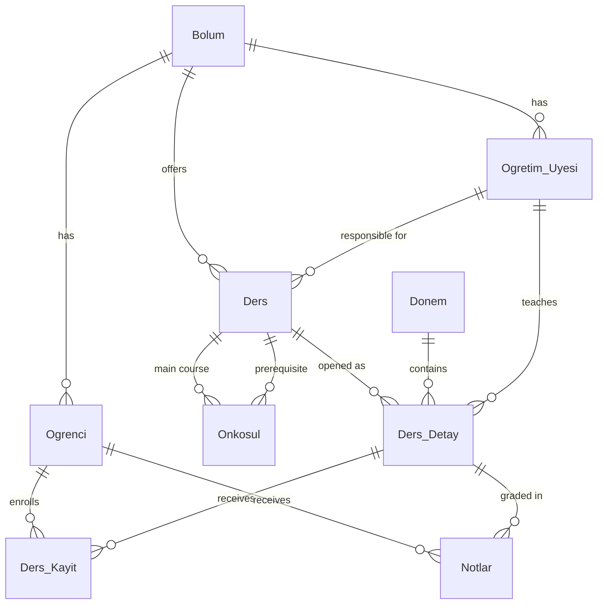

# 🎓 University Course Registration System

A web application for university students, instructors and administrators, built with **ASP.NET Core MVC** and **SQL Server**. Students enroll in courses and track their grades, instructors enter grades, and administrators manage students, instructors, courses and semesters.

> Final project for a university Database course.


> **Note:** The user interface and the database schema are in Turkish. This README explains the Turkish names where they appear.

---

## 📑 Table of Contents

- [Features](#-features)
- [Tech Stack](#-tech-stack)
- [Project Structure](#-project-structure)
- [Database Design](#-database-design)
- [Getting Started](#-getting-started)
- [Default Login Credentials](#-default-login-credentials)
- [Grading Rules](#-grading-rules)
- [Known Limitations](#-known-limitations)

---

## ✨ Features

The system has three user roles. After logging in, each user is taken to the dashboard for their role.

### 👨‍🎓 Student (`Ogrenci`)
- **Dashboard:** Summary of student number, year, department/faculty and contact details
- **Personal information:** Update phone number, e-mail and address
- **Course registration:** View and select the courses (mandatory / elective) offered by the student's own department
- **Semester grades:** View midterm, final and letter grades, plus the credit-weighted **semester GPA**

### 👩‍🏫 Instructor (`OgretimUyesi`)
- List the course sections they teach
- Enter **midterm / final** grades for enrolled students
- Letter grades are calculated automatically

### 🛡️ Administrator (`Yonetici`)
- **Student management:** List, add, edit and delete students (deleting a student also removes their grades and enrollments)
- **Academic staff:** Add, list and delete instructors
- **Course catalog:** Add and delete courses, and assign each course to a department and an instructor
- **Semester operations:** **Open** a catalog course for a specific semester with a set quota

### 🔐 Other
- Session-based authentication (the session expires after 20 minutes of inactivity)
- "Forgot password" dialog protected by a simple math captcha

---

## 🛠 Tech Stack

| Layer | Technology |
|---|---|
| Backend | ASP.NET Core MVC (.NET 9) |
| ORM | Entity Framework Core 8 (database-first) |
| Database | Microsoft SQL Server / LocalDB |
| Frontend | Razor Views, Bootstrap 5.3, Bootstrap Icons, jQuery |

---

## 📁 Project Structure

```
university-course-registration/
├── Database/
│   └── DersKayitSistemi.sql          # Database schema + sample data
├── DersTakipSistemiProje/
│   ├── DersTakipSistemiProje.sln
│   └── DersTakipSistemiProje/
│       ├── Controllers/
│       │   ├── AccountController.cs        # Login, logout, password reminder
│       │   ├── HomeController.cs           # Role-based dashboard
│       │   ├── OgrenciController.cs        # Student features
│       │   ├── OgretimUyesiController.cs   # Instructor courses and grade entry
│       │   └── YoneticiController.cs       # Administrator features
│       ├── Models/                         # EF Core entities + DbContext
│       ├── Views/                          # Razor views (one folder per role)
│       ├── wwwroot/                        # Static files
│       ├── Program.cs
│       └── appsettings*.json
└── README.md
```

---

## 🗄 Database Design

The database has 10 tables:

| Table | English | Description |
|---|---|---|
| `Bolum` | Department | Departments and the faculty each belongs to |
| `Ogrenci` | Student | Student details and login password |
| `Ogretim_Uyesi` | Instructor | Instructor details, academic title and login password |
| `Yonetici` | Administrator | Administrator accounts |
| `Ders` | Course | Course catalog (code, name, credits, type, department, responsible instructor) |
| `Onkosul` | Prerequisite | Prerequisite relationships between courses (many-to-many) |
| `Donem` | Semester | Academic semesters (year + `Güz` = Fall / `Bahar` = Spring) |
| `Ders_Detay` | Course Section | A course opened in a specific semester (instructor, quota) |
| `Ders_Kayit` | Enrollment | Student ↔ course section enrollments |
| `Notlar` | Grades | A student's midterm, final and letter grade for a course section |



**Constraints:** `Donem.Yariyil` must be either `Güz` (Fall) or `Bahar` (Spring), `Ders_Detay.Kontenjan` (quota) must be greater than 0, and `Yonetici.Kullanici_Adi` (username) is unique.

---

## 🚀 Getting Started

### Prerequisites
- [.NET 9 SDK](https://dotnet.microsoft.com/download/dotnet/9.0)
- SQL Server or **SQL Server Express LocalDB** (included with Visual Studio)
- Visual Studio 2022 (recommended) or VS Code

### 1. Clone the repository

```bash
git clone https://github.com/Yavuzgmus/university-course-registration.git
cd university-course-registration
```

### 2. Create the database

The `Database/DersKayitSistemi.sql` script creates the database and its tables, then loads the sample data (6 departments, 18 instructors, 30 students, 61 courses).

**From the command line (LocalDB):**

```bash
sqlcmd -S "(localdb)\MSSQLLocalDB" -E -f 65001 -i Database/DersKayitSistemi.sql
```

**Or** open the file in SSMS or Visual Studio's *SQL Server Object Explorer* and run it.

> ⚠️ If a database named `DersKayitSistemi` already exists, the script drops it and creates it again.

### 3. Check the connection string

The default connection string is in `appsettings.Development.json` and uses LocalDB:

```json
"ConnectionStrings": {
  "DefaultConnection": "Server=(localdb)\\MSSQLLocalDB;Database=DersKayitSistemi;Trusted_Connection=True;TrustServerCertificate=True;"
}
```

If you use a different SQL Server instance, change the `Server=` value to point to it.

### 4. Run the application

**Visual Studio:** Open `DersTakipSistemiProje/DersTakipSistemiProje.sln` and press **F5**.

**Command line:**

```bash
dotnet run --project DersTakipSistemiProje/DersTakipSistemiProje
```

By default the app runs at `http://localhost:5146` (or `https://localhost:7133` with the https profile) and opens on the login page.

---

## 🔑 Default Login Credentials

The sample data includes these accounts:

| Role | Username / Number | Password |
|---|---|---|
| Administrator | `admin` | `1234` |
| Student | `2001` (any from 2001–2030) | `123` |
| Instructor | `101` (any from 101–118) | `123` |

Students and instructors log in with their **ID number**; the administrator logs in with a **username**.

---

## 📊 Grading Rules

Average = **Midterm × 40% + Final × 60%**

| Average | Letter | Grade Points |
|---|---|---|
| 90 – 100 | AA | 4.0 |
| 85 – 89 | BA | 3.5 |
| 80 – 84 | BB | 3.0 |
| 75 – 79 | CB | 2.5 |
| 70 – 74 | CC | 2.0 |
| 65 – 69 | DC | 1.5 |
| 60 – 64 | DD | 1.0 |
| 50 – 59 | FD | 0.0 |
| < 50 | FF | 0.0 |

- If the final exam score is **below 35**, the letter grade is **FF** regardless of the average.
- Courses without a final grade show **NA** (not available) and are left out of the GPA.
- The semester GPA is the average of grade points, weighted by course credits.

---

## ⚠️ Known Limitations

This project was built for educational purposes. Before any real-world use, these points would need to be addressed:

- Passwords are stored in the database as **plain text** (not hashed).
- The "Forgot password" feature shows the password directly on screen.
- Authorization uses role checks stored in the session instead of ASP.NET Core Identity.
- Forms have no CSRF (anti-forgery token) protection.