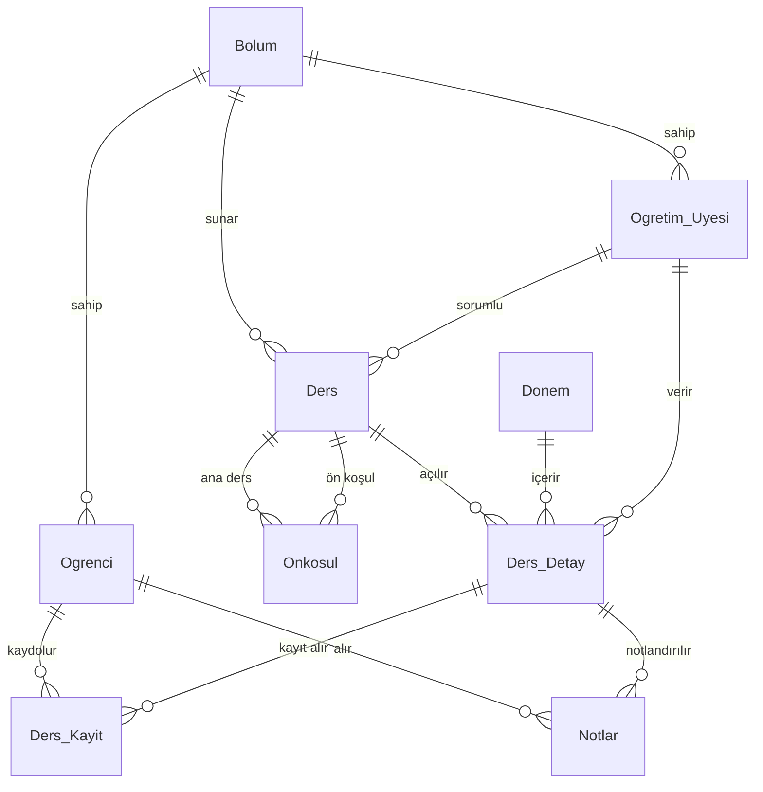

# 🎓 Ders Kayıt Sistemi

Üniversite öğrencileri, öğretim üyeleri ve yöneticiler için geliştirilmiş, **ASP.NET Core MVC** ve **SQL Server** tabanlı web uygulaması. Öğrenciler ders seçip notlarını takip eder, öğretim üyeleri not girer, yöneticiler ise öğrenci, akademisyen, ders ve dönem işlemlerini yönetir.

> Veritabanı dersi final projesi.


---

## 📑 İçindekiler

- [Özellikler](#-özellikler)
- [Kullanılan Teknolojiler](#-kullanılan-teknolojiler)
- [Proje Yapısı](#-proje-yapısı)
- [Veritabanı Tasarımı](#-veritabanı-tasarımı)
- [Kurulum](#-kurulum)
- [Varsayılan Giriş Bilgileri](#-varsayılan-giriş-bilgileri)
- [Not Hesaplama Kuralları](#-not-hesaplama-kuralları)
- [Bilinen Kısıtlar](#-bilinen-kısıtlar)

---

## ✨ Özellikler

Sistemde üç farklı kullanıcı rolü vardır. Giriş yapan kullanıcı, rolüne göre kendi paneline yönlendirilir.

### 👨‍🎓 Öğrenci
- **Ana sayfa:** Öğrenci numarası, sınıf, bölüm/fakülte ve iletişim bilgilerinin özeti
- **Kişisel bilgiler:** Telefon, e-posta ve adres bilgilerini güncelleme
- **Ders kayıt:** Kendi bölümünde açılan dersleri (zorunlu / seçmeli) görüntüleyip seçme
- **Dönem notları:** Vize, final ve harf notlarını görme; kredi ağırlıklı **dönem ortalaması (YANO)** hesaplama

### 👩‍🏫 Öğretim Üyesi
- Sorumlu olduğu açılmış dersleri listeleme
- Derse kayıtlı öğrencilerin **vize / final** notlarını girme
- Harf notunun otomatik hesaplanması

### 🛡️ Yönetici
- **Öğrenci yönetimi:** Listeleme, ekleme, düzenleme, silme (ilişkili not ve kayıtlarla birlikte)
- **Akademik kadro:** Öğretim üyesi ekleme, listeleme, silme
- **Ders kataloğu:** Ders ekleme / silme, derse bölüm ve öğretim üyesi atama
- **Dönem işlemleri:** Katalogdaki bir dersi belirli bir döneme kontenjanla **açma**

### 🔐 Diğer
- Session tabanlı oturum yönetimi (20 dk hareketsizlikte oturum sonlanır)
- Basit matematik sorulu (captcha) "Şifremi Unuttum" penceresi

---

## 🛠 Kullanılan Teknolojiler

| Katman | Teknoloji |
|---|---|
| Backend | ASP.NET Core MVC (.NET 9) |
| ORM | Entity Framework Core 8 (Database-First) |
| Veritabanı | Microsoft SQL Server / LocalDB |
| Frontend | Razor Views, Bootstrap 5.3, Bootstrap Icons, jQuery |

---

## 📁 Proje Yapısı

```
DataBaseProjectFinal/
├── Database/
│   └── DersKayitSistemi.sql          # Veritabanı şeması + örnek veriler
├── DersTakipSistemiProje/
│   ├── DersTakipSistemiProje.sln
│   └── DersTakipSistemiProje/
│       ├── Controllers/
│       │   ├── AccountController.cs        # Giriş, çıkış, şifre hatırlatma
│       │   ├── HomeController.cs           # Role göre ana sayfa
│       │   ├── OgrenciController.cs        # Öğrenci işlemleri
│       │   ├── OgretimUyesiController.cs   # Ders listesi ve not girişi
│       │   └── YoneticiController.cs       # Yönetim paneli işlemleri
│       ├── Models/                         # EF Core varlık sınıfları + DbContext
│       ├── Views/                          # Razor sayfaları (rol bazlı klasörler)
│       ├── wwwroot/                        # Statik dosyalar
│       ├── Program.cs
│       └── appsettings*.json
└── README.md
```

---

## 🗄 Veritabanı Tasarımı

Veritabanı 10 tablodan oluşur:

| Tablo | Açıklama |
|---|---|
| `Bolum` | Bölümler ve bağlı oldukları fakülte |
| `Ogrenci` | Öğrenci bilgileri ve giriş şifresi |
| `Ogretim_Uyesi` | Akademisyen bilgileri, unvan ve giriş şifresi |
| `Yonetici` | Yönetici hesapları |
| `Ders` | Ders kataloğu (kod, ad, kredi, tür, bölüm, sorumlu hoca) |
| `Onkosul` | Dersler arası ön koşul ilişkisi (çoka-çok) |
| `Donem` | Akademik dönemler (yıl + Güz/Bahar) |
| `Ders_Detay` | Bir dersin belirli bir dönemde açılmış hâli (hoca, kontenjan) |
| `Ders_Kayit` | Öğrenci ↔ açılan ders kayıtları |
| `Notlar` | Öğrencinin açılan dersteki vize, final ve harf notu |



**Kısıtlar:** `Donem.Yariyil` yalnızca `Güz` veya `Bahar` olabilir, `Ders_Detay.Kontenjan > 0` olmalıdır, `Yonetici.Kullanici_Adi` benzersizdir.

---

## 🚀 Kurulum

### Gereksinimler
- [.NET 9 SDK](https://dotnet.microsoft.com/download/dotnet/9.0)
- SQL Server veya **SQL Server Express LocalDB** (Visual Studio ile birlikte gelir)
- Visual Studio 2022 (önerilir) veya VS Code

### 1. Depoyu klonlayın

```bash
git clone https://github.com/Yavuzgmus/DataBaseProjectFinal.git
```

### 2. Veritabanını oluşturun

`Database/DersKayitSistemi.sql` betiği veritabanını, tabloları ve örnek verileri (6 bölüm, 18 öğretim üyesi, 30 öğrenci, 61 ders) oluşturur.

**Komut satırından (LocalDB):**

```bash
sqlcmd -S "(localdb)\MSSQLLocalDB" -E -f 65001 -i Database/DersKayitSistemi.sql
```

**veya** SSMS / Visual Studio *SQL Server Object Explorer* ile dosyayı açıp çalıştırın.

> ⚠️ Betik, aynı isimde (`DersKayitSistemi`) bir veritabanı varsa onu silip yeniden oluşturur.

### 3. Bağlantı dizesini kontrol edin

Varsayılan bağlantı dizesi `appsettings.Development.json` içindedir ve LocalDB'yi kullanır:

```json
"ConnectionStrings": {
  "DefaultConnection": "Server=(localdb)\\MSSQLLocalDB;Database=DersKayitSistemi;Trusted_Connection=True;TrustServerCertificate=True;"
}
```

Farklı bir SQL Server örneği kullanıyorsanız `Server=` kısmını kendi sunucunuza göre değiştirin.

### 4. Uygulamayı çalıştırın

**Visual Studio:** `DersTakipSistemiProje/DersTakipSistemiProje.sln` dosyasını açıp **F5** ile çalıştırın.

**Komut satırı:**

```bash
dotnet run --project DersTakipSistemiProje/DersTakipSistemiProje
```

Uygulama varsayılan olarak `http://localhost:5146` (https profili ile `https://localhost:7133`) adresinde açılır ve giriş sayfasıyla başlar.

---

## 🔑 Varsayılan Giriş Bilgileri

Örnek verilerle birlikte aşağıdaki hesaplar hazır gelir:

| Rol | Kullanıcı Adı / No | Şifre |
|---|---|---|
| Yönetici | `admin` | `1234` |
| Öğrenci | `2001` (2001–2030 arası) | `123` |
| Öğretim Üyesi | `101` (101–118 arası) | `123` |

Öğrenci ve öğretim üyeleri **numaralarıyla**, yönetici ise **kullanıcı adıyla** giriş yapar.

---

## 📊 Not Hesaplama Kuralları

Ortalama = **Vize × %40 + Final × %60**

| Ortalama | Harf | Katsayı |
|---|---|---|
| 90 – 100 | AA | 4.0 |
| 85 – 89 | BA | 3.5 |
| 80 – 84 | BB | 3.0 |
| 75 – 79 | CB | 2.5 |
| 70 – 74 | CC | 2.0 |
| 65 – 69 | DC | 1.5 |
| 60 – 64 | DD | 1.0 |
| 50 – 59 | FD | 0.0 |
| < 50 | FF | 0.0 |

- Final notu **35'in altındaysa** ortalamadan bağımsız olarak **FF** verilir.
- Final notu girilmemiş derslerin harf notu **NA** (not girilmedi) olarak görünür ve dönem ortalamasına katılmaz.
- Dönem ortalaması, harf notu katsayılarının ders kredileriyle ağırlıklı ortalamasıdır.

---

## ⚠️ Bilinen Kısıtlar

Bu proje eğitim amaçlı geliştirilmiştir; gerçek ortamda kullanılmadan önce şu noktaların iyileştirilmesi gerekir:

- Şifreler veritabanında **düz metin** olarak saklanmaktadır (hash'lenmemiştir).
- "Şifremi Unuttum" özelliği şifreyi doğrudan ekranda gösterir.
- Yetkilendirme, ASP.NET Core Identity yerine Session üzerinden rol kontrolüyle yapılmaktadır.
- Formlarda CSRF (anti-forgery token) koruması bulunmamaktadır.
